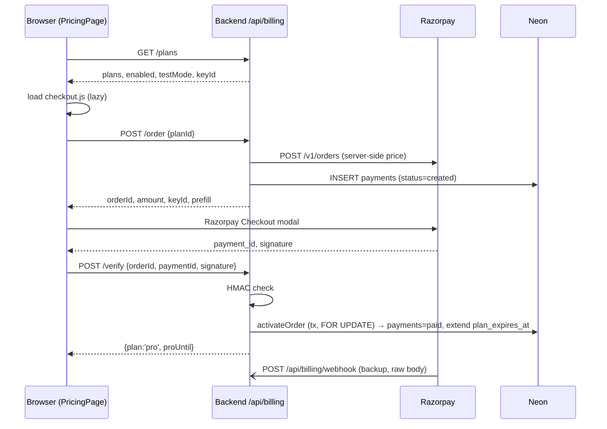

# Pro edition: implementation status

_Audited against the code on 2026-11-18. File and line references point at the code as of commit `e6f6bb4`._

## TL;DR

- **Payments work.** A signed-in user can buy Pro through Razorpay, the payment is verified on the server, and the account becomes Pro for 30 or 365 days.
- **Pro now unlocks one real feature: AI code score and analysis** on every Run and Submit (`POST /api/ai/review`, guarded by `requirePro`). The other five lines on the pricing page are still *Soon*.
- **Pricing bug:** the yearly plan costs **₹1** on the server (`amount: 100` paise). Fix this before taking live payments.

---

## 1. What Pro is

- A **one-time pass** for 30 days (`pro_monthly`, ₹199) or 365 days (`pro_yearly`, meant to be ₹1,499). It does not auto-renew. Buying again adds days on top of the time left.
- A user is Pro while `users.plan_expires_at` is in the future. When it passes, the account goes back to Free and keeps all its data.
- **Prerequisites:** both `DATABASE_URL` (Neon) and `RAZORPAY_KEY_ID` + `RAZORPAY_KEY_SECRET`. `RAZORPAY_WEBHOOK_SECRET` is optional but recommended. Without Neon and Razorpay, `/api/billing/order` and `/verify` return 503 and the pricing page disables the button with an explanation. In file mode (no database) Pro can't exist, because there are no accounts.

## 2. Architecture and flow

| Step | Where |
|---|---|
| Route `/pricing` | `frontend/src/App.jsx:298`; links in `components/Navbar.jsx:112`, `components/Footer.jsx:50` |
| Pricing UI, toggle, FAQ, checkout | `frontend/src/components/PricingPage.jsx` |
| API client | `frontend/src/services/api.js:483` `getBillingPlans`, `:492` `startCheckout`, `:496` `verifyPayment` |
| Prices (server-only source of truth) | `backend/data/billing.js:11` `PLANS` |
| Pro status from a user row | `backend/data/billing.js:20` `proStatus` |
| Create order | `backend/data/billing.js:27` `createOrder` |
| Signature checks | `backend/data/billing.js:65` (checkout), `:71` (webhook) |
| Activate, idempotent | `backend/data/billing.js:82` `activateOrder` |
| Routes | `backend/routes/billing.js:15` plans, `:23` order, `:46` verify, `:69` webhook |
| Webhook mounted with raw body | `backend/server.js:27` |
| Pro fields on the user object | `backend/routes/auth.js:30` (`...proStatus(row)`) |
| Schema | `backend/data/neon.js:74-90` |

**How Pro status reaches the UI:** login and `GET /auth/me` return `plan` (`'pro' | 'free'`) and `proUntil`. `App.jsx` stores the result in `currentUser`. After a successful payment, `PricingPage` calls `onUserUpdate` and `App.jsx:302` merges `{plan, proUntil}` into `currentUser`. **Only `PricingPage` reads `currentUser.plan`.**

## 3. Data model

**`users.plan_expires_at timestamptz`** (nullable). Pro while it is later than now.

**`payments`**

| Column | Notes |
|---|---|
| `order_id` text PK | Razorpay order id |
| `user_id` uuid | FK → users, cascade delete |
| `plan_id` text | `pro_monthly` / `pro_yearly` |
| `amount` int, `currency` text | In paise, copied from `PLANS` when the order is created |
| `status` text | `created` → `paid` → `refunded` (a full refund). A checkout that was opened but never paid stays `created` |
| `payment_id` text unique | Set on activation |
| `created_at`, `paid_at` | |

## 4. API

| Method | Path | Auth | Returns |
|---|---|---|---|
| GET | `/api/billing/plans` | public | `{ plans[], enabled, testMode, keyId }` |
| POST | `/api/billing/order` | signed in | `{ keyId, orderId, amount, currency, planName, prefill }`; 503 when payments are off |
| POST | `/api/billing/verify` | signed in | `{ plan, proUntil }`; 400 on a bad signature or someone else's order |
| POST | `/api/billing/webhook` | Razorpay signature | `{ ok: true }`; handles `payment.captured` and `order.paid`, checks the amount |

## 5. Checklist

### Payments core
- [x] Server-side plan prices (browser can't set the amount)
- [x] Razorpay order creation and `payments` ledger
- [x] Checkout signature verification (timing-safe HMAC)
- [x] Webhook with raw-body signature check and amount check
- [x] Idempotent activation in a transaction (checkout callback and webhook can both fire)
- [x] Extensions stack on the remaining time
- [x] Test/live mode detection and a startup log line
- [ ] **Fix the yearly price**: `billing.js:13` is `amount: 100` (₹1); should be `149900` to match the `PricingPage.jsx` fallback
- [x] Refunds: the `refund.processed` webhook marks a fully refunded payment `refunded` and takes that purchase's days off Pro (stacked purchases keep their own days; partial refunds and retries change nothing). Needs the `refund.processed` event ticked in the Razorpay webhook settings
- [ ] Failed payments are not recorded (a failed attempt just stays `created`)

### Entitlement and gating
- [x] `plan` / `proUntil` on the user object
- [x] Backend `requirePro` middleware in `backend/data/billing.js` (402 with `upgrade: true` for Free accounts; open in file mode)
- [ ] Frontend `isPro(user)` helper (e.g. in `lib/userData.js`, next to `isSignedIn`)
- [x] Upsell on a 402: the score bar shows "AI scoring is part of Pro" with a link to `/pricing` (`ScoreBar.jsx`)
- [x] First gated feature: AI code review

### Pro features
- [x] **AI code score and analysis**: a 0-100 bar after every Run/Submit (tests 40 + time 40 + space 20, graded by Gemini against the best known approach), and a centred popup after an accepted Submit with the code, time and space complexity, the main idea and, when not optimal, a better way to think about it. `backend/data/ai-review.js`, `code-score.js`, `routes/ai.js`; analyses are cached by code hash and limited per person per day. Off without `GEMINI_API_KEY`. The verdict also feeds the next-problem recommender

Still marked *Soon* on the pricing page:
- [ ] **Company-wise sheets.** Sheet cards exist in `PracticeHub.jsx:103-225`, but only DailyCode 150 is `live: true`. There is no company tagging data.
- [x] **Smart revision**: first review in 1 to 4 days depending on how the solve went (solution → tomorrow, hint → 2 days), then gaps adapt to Hard / Good / Easy ratings (SM-2 style), struggles nobody flagged are picked up from editor attempts, mastered past 45 days. Computed on the server only (`backend/data/smart-revision.js`, `GET /api/planner/revision`, Pro-checked), so it can't be unlocked in the browser; ratings stored as `reviewResults` on the plan question. Free keeps the fixed 3 / 7 / 21 days
- [ ] **Mock interview mode** (2 problems in 45 minutes, scored). Could reuse `CodeWorkspace`, the execution harness and `FocusTimer.jsx`.
- [x] **Detailed analytics** (first version): `GET /api/planner/progress` returns a per-topic breakdown, weak topics, what is still to cover and an on-track check against the plan, for Pro only (`backend/data/progress.js`, shown in `ProgressCard.jsx`). Free gets the basics (solved, today, streak, topics started, revisions due). Not yet: trends over time, time-per-topic, an estimated finish date
- [ ] **Morning email** with the day's plan. `backend/data/mailer.js` can send mail (Brevo/Resend/SMTP) but only has `sendVerificationCode`. There is no scheduler/cron, and the Render free tier sleeps, so it needs an external cron hitting an endpoint.

### Account UX
- [x] "Active until …" on the pricing page; button reads "Add a month/year" for Pro users
- [x] Clear messages when the server is offline or payments aren't configured; test-card hint in test mode
- [x] Pro badge next to the name in the Navbar (`lib/pro.js` `isPro`)
- [x] Expiry notice in the last 7 days and a "Pro ended" notice for 14 days after (`ProNotice.jsx`, dismissible per day)
- [x] Billing history: `GET /api/billing/history`, shown as "Your payments" on the pricing page
- [ ] Receipts/invoices (GST invoice if selling in India)
- [x] Cached profile (`codestreak_auth_user`) updated after payment, so an offline reload still shows Pro

### Ops
- [x] Webhook backup if the browser closes after paying
- [ ] Admin/reconciliation view for orders stuck in `created`
- [ ] Terms, refund policy and contact pages (Razorpay requires these for live mode)
- [x] Tests: orders, checkout and webhook signatures, activation, repeats, stacking, expiry and refunds all run against a real (in-memory) Postgres in `backend/test/production.e2e.test.js`

## 6. Known issues

1. **₹1 yearly plan** (`backend/data/billing.js:13`). Live customers would pay ₹1 for a year, and the pricing page's "save X%" badge would show about 100%.
2. ~~Paying unlocks nothing.~~ Fixed: AI code review is Pro-only.
3. **Stale cached profile after payment** (see Account UX).
4. **Naming:** `frontend/src/data/premiumProblems.js` holds the 7 **LeetCode Premium** problems, which are free to everyone. They have nothing to do with the Pro plan.

## 7. Suggested build order

1. Fix the yearly price.
2. Entitlement layer: `requirePro` middleware, `isPro(user)` helper, lock/upsell component, and the localStorage sync fix.
3. First real feature. **Smart revision** or **detailed analytics** are the cheapest, since the data already exists (solve status, `/api/stats`).
4. Pro badge and expiry warning.
5. Billing history, plus failed/refund states.
6. Mock interview mode.
7. Company-wise sheets (needs data curation).
8. Morning email (needs an external cron).

## 8. Testing Pro locally

1. In `backend/.env`, set `DATABASE_URL` and `rzp_test_` keys for `RAZORPAY_KEY_ID` / `RAZORPAY_KEY_SECRET`. Start the backend; it should log `[billing] Razorpay on (test mode)`.
2. Start the frontend, sign up (the verification code prints in the backend console if mail isn't set up), and open `/pricing`.
3. Pay with card `4111 1111 1111 1111`, any future expiry and any CVV.
4. Expect "You're on Pro until …". `GET /api/auth/me` should return `plan: "pro"`, and the `payments` row should show `status = 'paid'`.
5. Webhook: expose the backend with a tunnel (e.g. ngrok or cloudflared), add `https://<tunnel>/api/billing/webhook` in the Razorpay dashboard with `payment.captured` and `order.paid`, and set `RAZORPAY_WEBHOOK_SECRET`.
